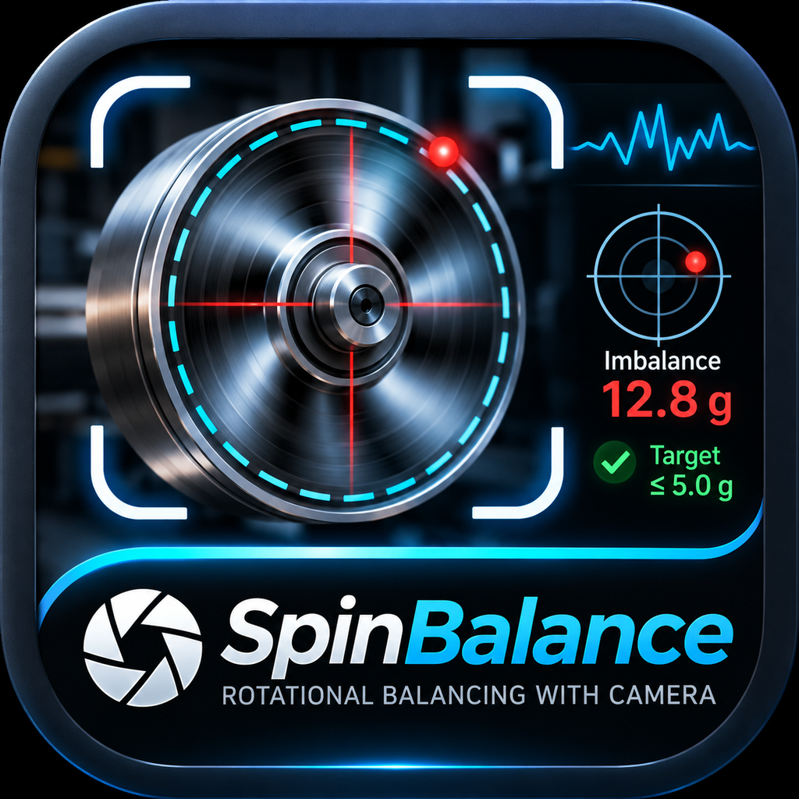

# Spin Balance

<p align="center"></p>

Telefon kamerasıyla dönen bir parçadaki **görünür optik kaçıklığı** izleyen deneysel Android uygulaması.

> **Önemli:** Bu uygulama gerçek kütle balansını veya eklenecek düzeltme ağırlığını belirlemez. Yalnızca görüntüdeki referans işaretinin yörüngesini ve mil merkezine göre görünür radyal değişimi tahmin eder.

## Özellikler

- Expo Camera ile Android kamera önizlemesi; tarayıcıda WebRTC kamera desteği.
- Görüntüde mil/dönüş merkezini elle işaretleme.
- Dönen yüzeye eklenen yüksek kontrastlı lime-yeşil referans işaretini takip etme.
- Tahmini optik sapma yönü, göreli görsel indeks, örnek sayısı ve açısal kapsam özeti.
- İsteğe bağlı rotor çapı girişiyle perspektif düzeltmesi yapılmamış kaba milimetre tahmini.
- Düşük ışık, kadraj ve kararsız takip için uyarılar; ölçümü durdurma ve yeniden başlatma.
- Kamera kareleri cihazda işlenir; uygulama bunları kaydetmez veya sunucuya yüklemez.

## Hızlı kullanım

1. Dönen parçayı **uygun koruyucu muhafaza içinde** çalıştırın. Kamerayı sabit bir desteğe alın; dönen parçaya veya çalışma alanına yaklaşmayın.
2. Kamera iznini verin ve milin yanı sıra dönen yüzeyin de kadrajda kaldığından emin olun.
3. Parça tamamen durmuşken üzerine küçük, mat ve yüksek kontrastlı lime-yeşil bir referans işareti güvenle sabitleyin. İşaret dönüş boyunca kamerada görünür kalmalıdır.
4. Canlı görüntüde **Mil merkezini işaretle** düğmesine dokunup dönüş eksenini görüntü üzerinde seçin.
5. İsterseniz bilinen rotor çapını milimetre olarak girin. Bu değer, perspektif kalibrasyonu olmayan yaklaşık bir ölçek sunar.
6. **Ölçümü başlat** düğmesine basın; geniş bir dönüş açısı toplanırken telefonu sabit tutun. Sonuçta gösterilen yön, işaretin optik yörüngesindeki görünür sapma yönüdür.

## Bilinen sınırlar ve güvenlik

- Tek kamera, parçanın **gizli kütle dağılımını** göremez; bu nedenle ağır tarafı, düzeltme ağırlığının yerini veya gerçek dinamik balansı hesaplamaz.
- Android telefon uygulaması yaklaşık **2 kare/sn**, web önizlemesi yaklaşık **6 kare/sn** örnekler. Bu prototip yalnızca yavaş dönüşleri izlemek içindir; yüksek devirli rotorlar, üretim ayarı ve güvenlik açısından kritik işler için uygun değildir.
- Görüş açısı, perspektif, aydınlatma, bulanıklık, titreşim ve kamera örnekleme hızı sonuçları etkileyebilir. Milimetre çıktısı kalibre edilmiş ölçüm değildir.
- Dönen ekipmanı çalıştırırken muhafazayı kapalı tutun. İşaret yalnızca ekipman durmuşken takılmalı veya ayarlanmalıdır. Endüstriyel balans için kalibre edilmiş balans cihazı ve üretici güvenlik prosedürleri kullanılmalıdır.

## Android APK

GitHub Actions, `main` dalına push/PR olduğunda veya elle başlatıldığında imzalanabilir bağımsız Android Release APK üretir. Son başarılı çalışmanın artifact'ını [GitHub Actions sayfasında](https://github.com/SerdarMSC/SpinBalance/actions/workflows/native-build.yml) `spinbalance-android-release-apk` adıyla indirin. Artifact'lar **14 gün** saklanır; indirilen arşivden `app-release.apk` dosyasını çıkarın.

Eski sürüm üzerine güncelleme imza uyuşmazlığı nedeniyle reddedilirse önce eski uygulamayı kaldırıp APK'yı yeniden kurun. Uygulama adı **Spin Balance**, Android paket kimliği **`com.mscsi.spinbalance`**'dir. CI şu anda yalnız Android APK üretir; iOS derlemesi workflow'a dahil değildir.

## Geliştirme

Gereksinimler: Node.js 22, pnpm 9.12.0 ve Android yerel derleme için JDK 17/Android SDK.

```bash
pnpm install --frozen-lockfile
pnpm dev
```

`pnpm dev`, API sunucusunu `3000` portunda ve Expo web geliştirme sunucusunu `8081` portunda başlatır. Android/emülatör geliştirmesi için API'yi ayrı bir terminalde `pnpm dev:server` ile çalıştırıp diğer terminalde `pnpm android` kullanın.

Kontroller:

```bash
pnpm check
pnpm test
pnpm lint
```

## CI ayrıntıları

Workflow: [`/.github/workflows/native-build.yml`](.github/workflows/native-build.yml). GitHub Actions, Node.js 22, pnpm 9.12.0, JDK 17 ve Android SDK ile native Android projesini üretir, `assembleRelease` çalıştırır ve APK boyutunu loglar. Release küçültmesi R8 kod küçültme ile kullanılmayan kaynakları kaldırmayı etkinleştirir.
